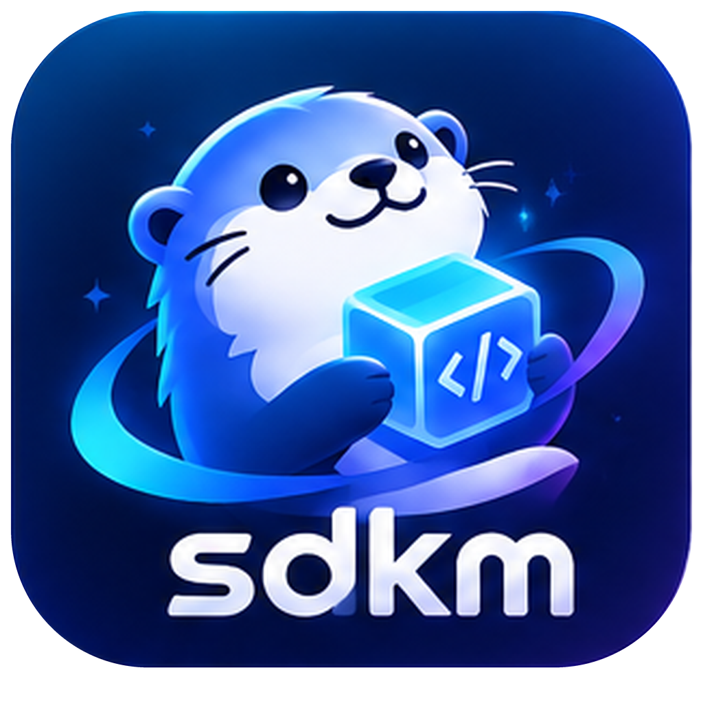
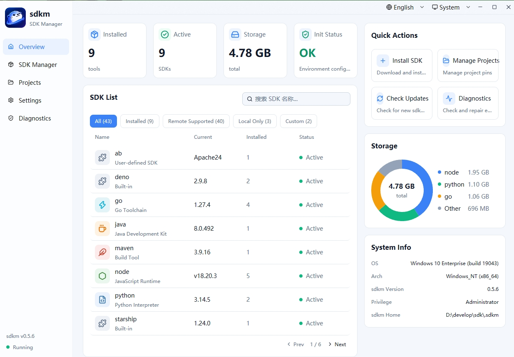
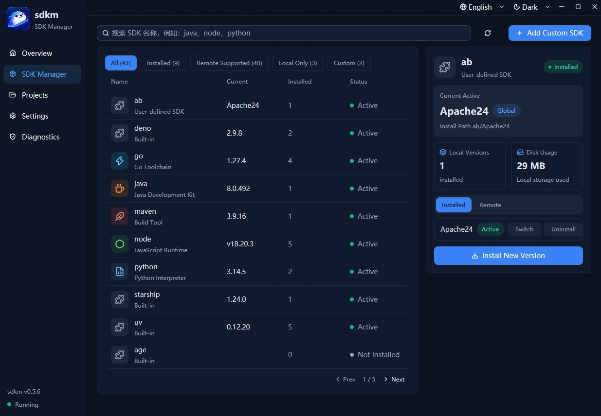
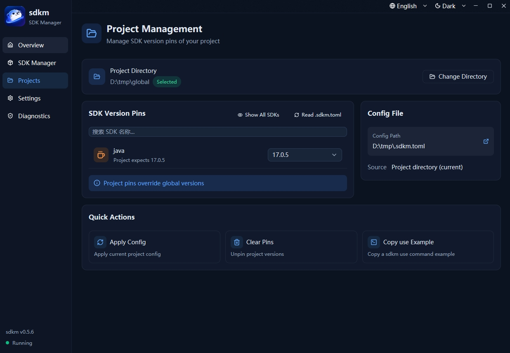
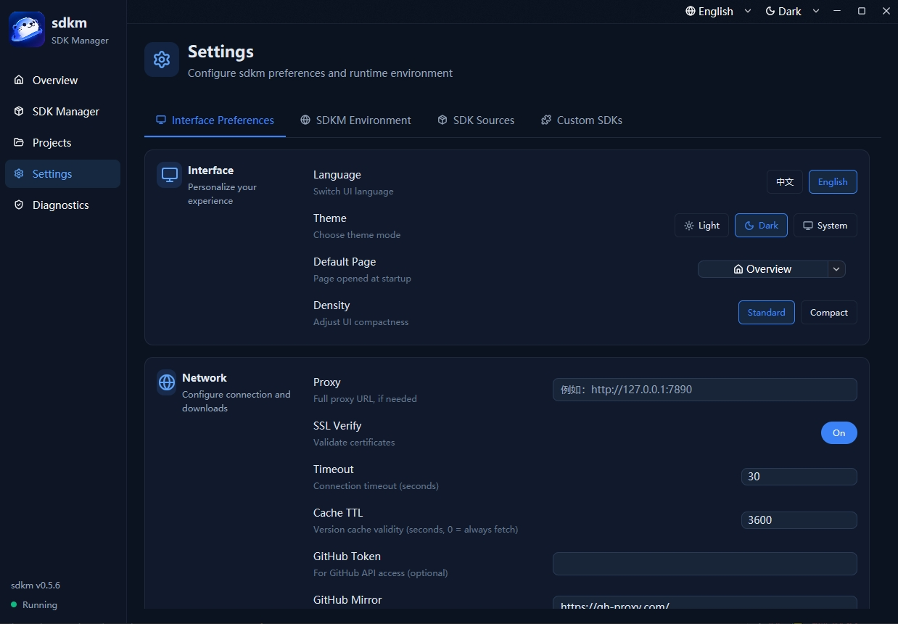
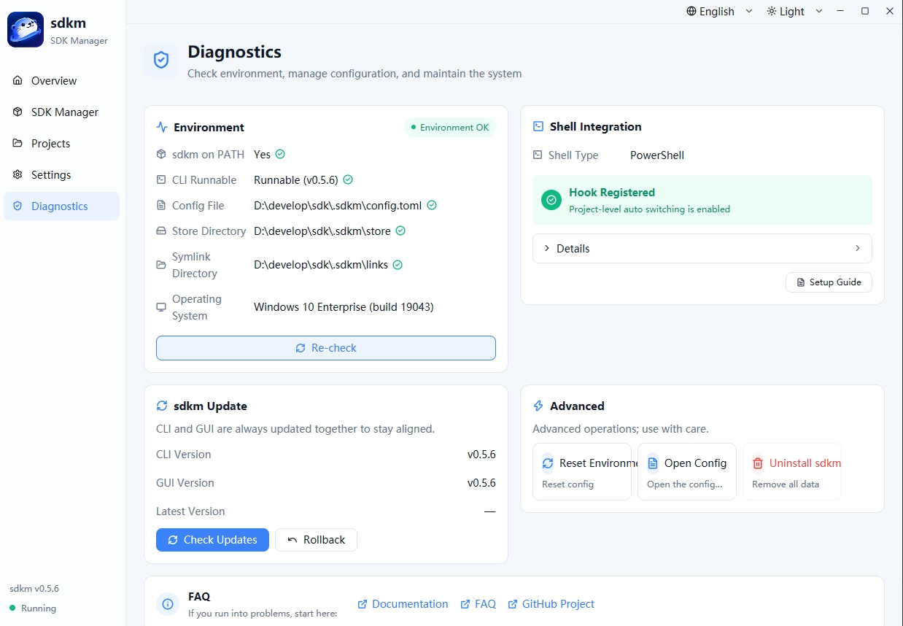

<div align="center">

  <h1 align="center">
    
  </h1>

  <!-- Badges: community -->
  <p>
    <a href="https://github.com/borenchan/sdkmate/stargazers"></a>
    <a href="https://github.com/borenchan/sdkmate/network/members"></a>
    <a href="https://github.com/borenchan/sdkmate/watchers"></a>
  </p>

  <!-- Badges: release & build -->
  <p>
    <a href="https://github.com/borenchan/sdkmate/releases"></a>
    <a href="https://github.com/borenchan/sdkmate/releases"></a>
    <a href="https://github.com/borenchan/sdkmate/releases"></a>
    <a href="https://github.com/borenchan/sdkmate/actions/workflows/release.yml"></a>
  </p>

  <!-- Badges: activity -->
  <p>
    <a href="https://github.com/borenchan/sdkmate/issues"></a>
    <a href="https://github.com/borenchan/sdkmate/pulls"></a>
    <a href="https://github.com/borenchan/sdkmate/commits/master"></a>
    <a href="https://github.com/borenchan/sdkmate/commits/master"></a>
    
  </p>

  <!-- Badges: tech stack -->
  <p>
    
    
    
  </p>

  <p>
    <strong>sdkmate (a.k.a. "时代楷模" 👀)</strong> is a <strong>pure-Rust</strong>, cross-platform SDK version manager with a native desktop app built on <a href="https://github.com/zed-industries/zed/tree/main/crates/gpui">GPUI</a>, for full-stack developers. Install and switch between Java, Node.js, Python, Maven, Go, uv, bun, claude-code, cmake ... and 40+ dev tools with one command — <strong>faster, safer, and more hassle-free than nvm / jenv / pyenv / sdkman</strong>.
  </p>
  <p>
    <strong>English</strong> ·
    <a href="./README-zh.md">简体中文</a>
  </p>

  <!-- Quick links -->
  <p>
    <a href="#-quick-start"></a>
    <a href="#-installation"></a>
    <a href="./docs/usage.md"></a>
    <a href="./skills/SKILL.md"></a>
    <a href="https://github.com/borenchan/sdkmate/issues"></a>
  </p>

  <!-- Demo -->
  <br/>

  

  <p><sub>▲ <strong>sdkm</strong> in action: install · fuzzy match · version switch · interactive TUI · project version management</sub></p>

  <a href="./assets/example-images/en/home_p1.jpg"></a>

  <p><sub>▲ <strong>sdkm-gui</strong>: native desktop app — visual SDK management, projects, settings and diagnostics on the same Rust core</sub></p>
</div>

---

## ✨ Core Advantages

> **One tool to replace nvm + jenv + pyenv + sdkman** — faster, safer, simpler, and more cross-platform.

<div align="center">
  <table>
    <tr>
      <td width="20%" align="center">
        <h3>🟢 Portable CLI · Lightweight</h3>
        <p>CLI single binary · zero runtime deps · <strong>~5MB</strong><br>Copy to USB and run — drop existing SDKs in to manage</p>
      </td>
      <td width="20%" align="center">
        <h3>🖥️ Native GUI</h3>
        <p>Built on GPUI · cross-platform desktop app<br>Visual SDK management · same Rust core as the CLI</p>
      </td>
      <td width="20%" align="center">
        <h3>⚡ Multi-scope version switching</h3>
        <p>Global · project · temp<br>auto-switch on cd · auto-restore on leave</p>
      </td>
      <td width="20%" align="center">
        <h3>🛡️ Transparent · Rollback-safe</h3>
        <p>Every step printed · auto-recover on failure<br>Fuzzy match 21→21.x · suggests closest</p>
      </td>
      <td width="20%" align="center">
        <h3>🤖 AI Agent Friendly</h3>
        <p>Bundled skill doc · clear exit codes<br>System-wide + rollback-safe · safe to call</p>
      </td>
    </tr>
  </table>
</div>

### 🔥 Designed for full-stack developers

Switching between Java, Node.js, Python, Go, Maven and other SDK versions is the norm for full-stack devs — you used to need nvm, jenv, pyenv, sdkman, multiple script tools, each in its own silo. **sdkm does it all with one Rust binary.**

- **🟢 Portable, green**: single binary, no background service. sdkm's `HOME` is the executable's folder — copy it to a USB stick or another machine, config and installed SDKs come along. Drop existing JDK / Node / Python into the `store/` directory and sdkm discovers and manages them.
- **⚡ Three scopes, switch on demand**: global (`switch` symlink + config, shell hook rebuilds PATH on every Enter — **takes effect as soon as you press Enter after switching**; on Windows `WM_SETTINGCHANGE` lets open processes notice), project (`use` writes `.sdkm.toml`, shell hook auto-switches on entry, restores on leave), and temp (`use --shell`, current-terminal override) — all three supported by one mechanism, pick as needed.
- **🛡️ Transparent and rollback-safe**: every step prints what it did and why; `switch` auto-rolls back to the pre-switch state if any step fails; `config` uses atomic write + snapshot rollback — the config file can never be left half-written.
- **🦀 Rust-driven, type-safe & reliable**: written in Rust — ownership and the type system eliminate whole classes of memory-safety bugs (dangling pointers, buffer overflows, data races) at compile time; compared to unchecked bash scripts, you get a compile-time safety net and won't silently fail on a typo or null. Paired with atomic writes + snapshot rollback, a failed operation never wrecks your environment.
- **🧩 Extensible, one tool for everything**: Java / Node.js / Python / Maven / Go and more built in; any tool downloadable from a URL can be registered as a custom SDK with one command. Config values are type-validated — bad values error on the spot — **say goodbye to "a version manager for every language".**
- **🖥️ Native cross-platform + interactive TUI**: Windows / Linux / macOS all first-class, same commands, same experience; `sdkm list <sdk> -r` opens an interactive TUI — arrow keys to browse remote versions, one-key install/switch, super friendly to use, and Windows is supported just as well!
- **🤖 AI-agent friendly, let AI manage your env**: ships with an [agent skill doc](./skills/SKILL.md) — Claude Code / Codex / openclaw and other agents read it once and can install/switch SDKs for you; CLI exit-code semantics are clear (0 success / 1 failure), commands fit scripts and CI naturally, and failed operations auto-roll back — agents can call it with confidence.

### 🤖 Let an AI Agent manage your SDKs

> It's 2026 — tired of too many CLI flags? Worried about the learning curve? Let an AI agent do it for you.

sdkm ships with a self-contained [agent skill doc](./skills/SKILL.md) — AI coding assistants like Claude Code, Codex read it once and can install/switch SDKs on your machine for you: they call `sdkm install` / `sdkm switch` directly, judge success by exit code, and auto-roll back on failure — no interactive prompts to get stuck on, no shell-function traps.

**Install the skill — either way works (Claude Code shown as an example):**

- **Simplest · let the agent install it**: in a Claude Code session, just say —

  ```
  help me install a skill: https://github.com/borenchan/sdkmate/blob/master/skills/SKILL.md
  ```

- **Manual copy**: drop `SKILL.md` at `~/.claude/skills/sdkm/SKILL.md` (`%USERPROFILE%\.claude\skills\sdkm\SKILL.md` on Windows) — globally available.

Once installed, **restart your Claude Code session** (so it picks up the new skill), then just talk to the agent in plain language — it will trigger the sdkm skill and run:

```
install java 21            → sdkm install java 21
switch to node 20.11.0     → sdkm switch node 20.11.0
what python do I have      → sdkm list
```

### 📊 Comparison with similar tools

| Capability | **sdkm** | **mise** | **sdkman** | **jvms / jenv / nvm / pyenv** |
| :--- | :---: | :--- | :--- | :--- |
| **Multi-language in one tool** | ✅ Java/Node/Python/Maven/Go + custom SDKs | ✅ node, python, cmake, terraform and [hundreds more](https://github.com/jdx/mise?tab=readme-ov-file#what-does-it-do) | ⚠️ Java/JVM ecosystem mainly | ❌ single-language manager, one tool per language (e.g. [nvm](https://github.com/nvm-sh/nvm?tab=readme-ov-file#node-version-manager---), [pyenv](https://github.com/pyenv/pyenv?tab=readme-ov-file#simple-python-version-management)) |
| **Native Windows support** | ✅ **First-class**: native registry + broadcast | ⚠️ **Basic**: Windows relies on core/vfox plugins, [limited tools](https://mise.jdx.dev/windows.html#windows-support) | ❌ officially WSL / Git Bash / Cygwin only, [install docs](https://sdkman.io/install) | ⚠️ third-party ports needed (e.g. [nvm-windows](https://github.com/coreybutler/nvm-windows), [pyenv-win](https://github.com/pyenv-win/pyenv-win)) |
| **Open processes sense the switch** | ✅ global-scope switch broadcasts `WM_SETTINGCHANGE` on Windows so open apps notice (project/temp scopes are in-shell, like others) | ❌ open processes don't re-read PATH; shims don't broadcast either | ❌ current shell only | ❌ current shell only |
| **Three switching scopes** | ✅ global (symlink + system PATH) / project (`.sdkm.toml` + hook) / temp (`use --shell`) — **zero runtime overhead for SDKs** | ✅ global / project (`.mise.toml`) / shell, but default shims layer [docs](https://mise.jdx.dev/installing-mise.html#installation) | ⚠️ `sdk use` is shell-only; `sdk default` for persist; no project pin [usage](https://sdkman.io/usage#sdk-use-command) | ⚠️ `.nvmrc` / `.python-version` project + shell; global via default — inconsistent mechanisms |
| **Path transparency (which/IDE)** | ✅ `which java` points to the real SDK path | ⚠️ with shims `which node` hits the shim; officially admits it "breaks `which`" — `mise which` shows the real path, [design notes](https://mise.jdx.dev/how-i-use-mise.html#shims-vs-path) | ✅ transparent | ✅ transparent (inside the shell) |
| **Fuzzy version match** | ✅ `21` → latest 21.x, with candidate suggestions | ✅ fuzzy versions (e.g. `node = "26"`) and closest match | ❌ no prefix fuzzy; exact versions only | ⚠️ partial prefix support, varies by tool |
| **Single-file portability** | ✅ single binary, only **5MB** + config dir — runs from a USB stick or any path | ⚠️ **100MB+**, needs a shims dir (`~/.local/share/mise/shims` or `%LOCALAPPDATA%\mise\shims`), [install docs](https://mise.jdx.dev/installing-mise.html#installation) | ❌ scripts + fixed install path | ❌ scripts + shell hooks, shell-dependent |
| **Rollback-safe operations** | ✅ snapshot auto-recovery (project feature) | ⚠️ rely on external means (e.g. back up config yourself) | ❌ no auto-rollback | ❌ no auto-rollback |
| **Language / memory safety** | ⚡ Rust ownership + compile-time checks | ⚡ Rust ownership + compile-time checks | 🐌 Bash / shell scripts | 🐌 Shell / bash scripts |
| **AI agent / automation friendly** | ✅ clear exit codes; child processes inherit the new env after switching; predictable behavior | ⚠️ must understand shims / PATH mode differences; non-interactive shells need shims or `mise exec`, [usage notes](https://mise.jdx.dev/how-i-use-mise.html#shims-vs-path) | ⚠️ shell function, doesn't cross processes | ⚠️ switch is current-shell only, invisible cross-process; extra scripting needed |

> **Honest advice**

1. To be honest, sdkm and mise are nearly the same class of tool — mise's ecosystem and features are more mature today. But sdkm focuses on doing one thing well right now: **fast, transparent, consistent cross-platform version switching**.

2. If you're already comfortable with mise / sdkman / nvm and work smoothly with them, there's no need to switch. sdkm best fits users in the **full-stack dev + native Windows + IDE + AI Agent** combination scenario.

---

## 📦 Installation

Download the archive for your platform from the [Releases](https://github.com/borenchan/sdkmate/releases) page:

- **CLI only** — `sdkm-<os>-<arch>[-gnu|-musl]`
- **Desktop (CLI + GUI)** — `sdkm-desktop-<os>-<arch>[-gnu]`, containing both `sdkm` and `sdkm-gui`

Extract anywhere (preserve the `.sdkm/` directory structure), then cd into `.sdkm/` to get started. On first launch the GUI offers a one-click initialization.

> **⚠️ Windows users**: run `init`/`switch` in an administrator terminal (writes system env vars `HKEY_LOCAL_MACHINE` + creates symbolic links).

---

## 🖥️ Desktop App

Don't want to memorize commands? sdkm also ships a simple, easy-to-use GUI, built on [GPUI](https://github.com/zed-industries/zed/tree/main/crates/gpui) and powered by the same Rust core. The Desktop archive (`sdkm-desktop-*`) includes both `sdkm` and `sdkm-gui`.

<p align="center"><sub>Click any screenshot to open the full-size image.</sub></p>

<table align="center">
  <tr>
    <td align="center" width="20%"><a href="./assets/example-images/en/home_p1.jpg"></a><br/><sub><strong>Overview</strong></sub></td>
    <td align="center" width="20%"><a href="./assets/example-images/en/sdkm_p2.jpg"></a><br/><sub><strong>SDK Management</strong></sub></td>
    <td align="center" width="20%"><a href="./assets/example-images/en/project_p3.jpg"></a><br/><sub><strong>Projects</strong></sub></td>
    <td align="center" width="20%"><a href="./assets/example-images/en/setting_p4.jpg"></a><br/><sub><strong>Settings</strong></sub></td>
    <td align="center" width="20%"><a href="./assets/example-images/en/doctor_p5.jpg"></a><br/><sub><strong>Diagnostics</strong></sub></td>
  </tr>
</table>

---

## 🚀 Quick Start

### 1️⃣ Initialize

```bash
.sdkm\sdkm.exe init          # Windows (first run: create dir structure, register PATH)
.sdkm/sdkm init              # Linux / macOS
```

### 2️⃣ Install or hand existing SDKs to sdkmate

```bash
# Install from remote (fuzzy match, auto-switch)
sdkm install java 21              # '21' → latest 21.x
sdkm install node 20.11.0

# Or hand existing SDKs to sdkmate (no re-download)
# Drop them under <sdkm-dir>/store/java/21/ — sdkm discovers them automatically
```

### 3️⃣ Switch versions

```bash
sdkm switch java 17        # Switch to locally installed Java 17
sdkm s node 20.11.0        # Switch to Node.js 20.11.0
```

### 4️⃣ Browse interactively

```bash
sdkm list                  # List all installed SDKs + current versions
sdkm list node -r          # Interactive remote Node.js picker — i to install, s to switch
sdkm current               # Show active versions of all SDKs
```

📖 **Full commands, args, config options and custom SDKs: see [Detailed Usage](./docs/usage.md)**.

---

## 🐚 Multi-scope version switching

sdkm switches versions across **three scopes**, from highest to lowest priority:

- **Temporary · this terminal**: `sdkm use --shell java 21` sets a temp env var, only affects this shell process, gone when the terminal closes.
- **Project · a directory (recommended)**: `sdkm use java 21` writes `.sdkm.toml` in the current dir; the shell hook auto-switches on entry and auto-restores on leave — edit, press Enter, it applies.
- **Global · the whole system**: `sdkm switch java 21` modifies the symlink and `config.toml`; the hook rebuilds PATH from config on every Enter — **takes effect as soon as you press Enter**, everywhere.

```bash
sdkm switch java 21                      # Global: Java 21 everywhere
sdkm use java 21                         # Project: Java 21 only in this dir (needs hook)
eval "$(sdkm use --shell java 21)"       # Temporary: this terminal only (highest priority, overrides both)
```

> Temporary and project scopes take effect via the shell hook; without it, only `switch` (global) works. Run `sdkm init` to auto-inject the hook — bash / zsh / fish / PowerShell supported.

📖 Manual hook registration, profile reset, hook mechanism & flow diagrams: see [Detailed Usage](./docs/usage.md).

---

## 🎮 Command Reference

| Command | Alias | What it does | Example |
|:---|:---|:---|:---|
| `sdkm init` | — | Initialize sdkmate | `sdkm init --force` |
| `sdkm install <SDK> <V>` | `i` | Install a version (fuzzy match, auto-switch) | `sdkm i java 21` |
| `sdkm uninstall <SDK> <V>` | `rm`, `un` | Uninstall a local SDK version | `sdkm rm node 16` |
| `sdkm list [SDK] [-r]` | `ls`, `l` | List/browse versions (interactive TUI) | `sdkm ls node -r` |
| `sdkm switch <SDK> <V>` | `s` | Switch to a locally installed version (global) | `sdkm s java 21` |
| `sdkm use <SDK> <V>` | — | Pin a version for the project / temp session (`--shell`) | `sdkm use java 21` |
| `sdkm current [SDK]` | `c` | Show the active version | `sdkm c java` |
| `sdkm env [SHELL]` | — | Emit env-var setup statements (temp switch) | `eval "$(sdkm env bash)"` |
| `sdkm hook [SHELL]` | — | Emit the shell hook script (auto-switch on cd) | `eval "$(sdkm hook bash)"` |
| `sdkm config` | — | Configuration management | `sdkm config edit` |
| `sdkm self update` | `u` | Upgrade sdkmate itself (`--check`/`--rollback`) | `sdkm self u --check` |
| `sdkm self uninstall` | — | Uninstall sdkmate (cleans env + home dir) | `sdkm self uninstall` |

---

## 🧰 Supported SDKs

| SDK | Status | Source |
|:---|:---:|:---|
| ☕ **Java (JDK)** | ✅ Supported | Adoptium Eclipse Temurin |
| 🟢 **Node.js** | ✅ Supported | nodejs.org |
| 🐍 **Python** | ✅ Supported | astral-sh python-build-standalone |
| 🧶 **Maven** | ✅ Supported | Apache Maven (dlcdn) |
| 🔵 **Go** | ✅ Supported | go.dev |
| 🚀 **uv / bun / claude-code / cmake / fzf / ripgrep / ... 40+ more** | ✅ Supported | GitHub Releases |
| ⚙️ **Custom SDK** | ✅ Infinitely extensible | User-configured (any URL) |

---

## 🔩 Tech Stack

| Component | Tech | Description |
|:---|:---|:---|
| **Language** | Rust 1.98 | Performance meets safety |
| **CLI parsing** | clap | Elegant argument handling |
| **Async runtime** | tokio | High-performance async IO |
| **HTTP client** | reqwest | Cross-platform HTTP |
| **Terminal output** | crossterm + indicatif | Colored output + progress bars |
| **Config parsing** | toml (serde) | Human-friendly config format |
| **Desktop App** | [GPUI](https://github.com/zed-industries/zed/tree/main/crates/gpui) (gpui-kit) | Native, GPU-accelerated desktop UI |

---

## 🔧 Development

### Requirements

- Rust 1.98 (edition 2024)
- Cargo

### Local development

```bash
# Clone the project
git clone https://github.com/borenchan/sdkmate.git
cd sdkmate

# Build
cargo build --release

# Run tests
cargo test

# Try it out
./target/release/sdkm init
./target/release/sdkm list
./target/release/sdkm switch java 21

# Code quality check
cargo fmt                                              # Format code
cargo clippy --all-targets --all-features              # Lint code
```

---

## 🤝 Contributing

Contributions of any kind are welcome — bug reports, feature ideas, or code.

### 📋 PR checklist

1. Fork the repo and create a branch: `git checkout -b feature/your-feature-name`
2. Write code and make sure all tests pass: `cargo test`
3. Keep the code style consistent (required before committing):
   ```bash
   cargo fmt                                  # Format code
   cargo clippy --all-targets --all-features  # Lint code, zero warnings
   ```
4. Commit with a clear message: `git commit -m "feat: add xxx"`
5. Push and open a Pull Request: `git push origin feature/your-feature-name`

### 📖 Conventions

| Type | Convention | Example |
|:---|:---|:---|
| Commit message | `type: description` | `feat: add switch command` |
| Types | feat / fix / docs / refactor / test / chore | — |
| Branch naming | `feature/xxx` / `fix/xxx` / `docs/xxx` | `feature/add-install-command` |

---

## 📄 License

This project is open-sourced under the [Apache-2.0](./LICENSE) license.

---

<div align="center">

**If this project helps you, please give it a ⭐!**

Made with ❤️ by the sdkm team

</div>

---

## ☕ Buy Me a Coffee

If sdkm has ever helped you, feel free to buy me a coffee — your support keeps this project going.

<p align="center">
  
  
</p>

---

## ⭐ Star History

<div align="center">

<a href="https://star-history.dera.page/#borenchan/sdkmate&type=date">
 <picture>
   <source media="(prefers-color-scheme: dark)" srcset="https://star-history.dera.page/svg?repos=borenchan/sdkmate&type=date&theme=dark&legend=top-left" />
   <source media="(prefers-color-scheme: light)" srcset="https://star-history.dera.page/svg?repos=borenchan/sdkmate&type=date&legend=top-left" />
   
 </picture>
</a>

</div>
