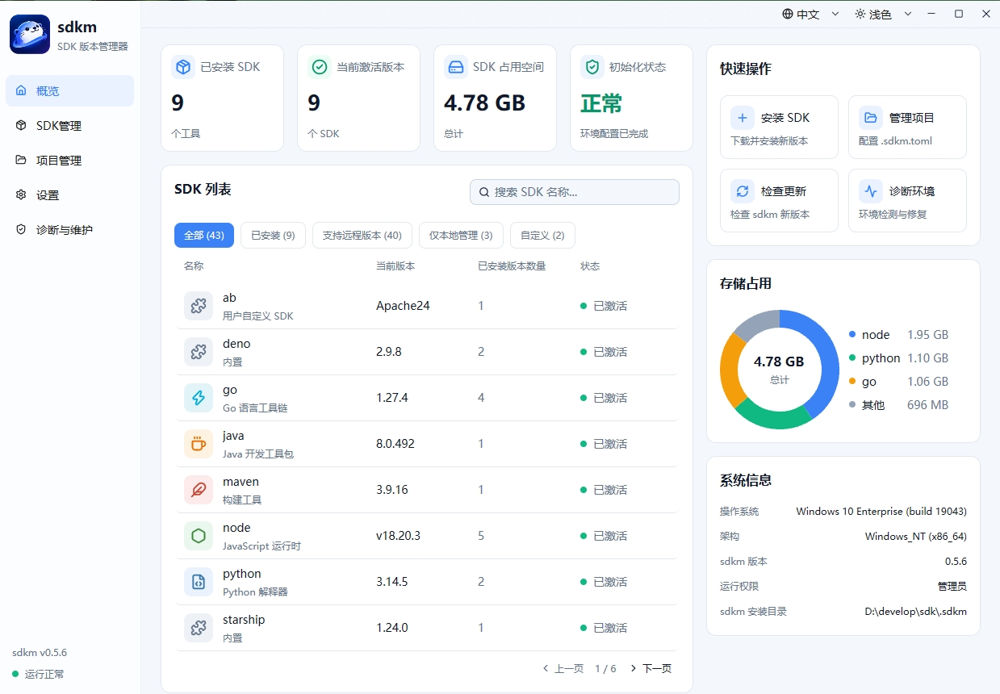

# 桌面应用（sdkm-gui）

> 读者：普通用户。

`sdkm-gui` 是 sdkm 的原生桌面应用，与 CLI 共用同一套 Rust 核心和同一份 `config.toml`——**CLI 能做的事，GUI 都能做**，包括安装 / 切换 / 卸载 SDK、配置项目版本约束、改网络与源设置、环境诊断与自更新。GUI 与 CLI 只是两个前端，数据与业务逻辑完全一致。

> 只想要命令行？看 [usage.md](./usage.md)。本文档只讲桌面端。

## 安装与启动

桌面版通过 `sdkm-desktop-*` 组合包分发，压缩包内 `.sdkm/` 目录同时包含 `sdkm`（CLI）和 `sdkm-gui`（GUI）。解压后进入 `.sdkm/`，直接运行 `sdkm-gui` 即可；两个二进制同目录，共享 `store/`、`links/`、`config.toml`。下载地址与产物命名见 [README](../README.md) 的 “Desktop App” 一节。

版本对齐：升级 `sdkm-gui` 时 CLI 会一起更新（`sdkm self update` 或 GUI 诊断页的更新入口），避免两个前端版本错配。

## 单实例

再次启动 `sdkm-gui.exe` 会激活已运行的窗口并退出（Windows；macOS / Linux 暂可多开）。

## 系统托盘

应用启动后在系统托盘（Windows 通知区 / macOS 菜单栏 / Linux StatusNotifier）常驻图标：

- **左键单击**：显示并聚焦主窗口。
- **右键菜单**（语言随界面偏好切换）：
  - `打开主界面`
  - `设置`：显示主窗口并直达设置页
  - `快速切换`：按 SDK 分组列出已安装版本，当前版本标 `✓`，点击即切换；没有已安装版本的 SDK 不出现，操作进行中整体置灰
  - `sdkm vX.Y.Z`：当前版本号（信息行，不可点击）
  - `重启应用` / `退出 sdkm`：操作进行中置灰，防止安装/卸载中途退出留下残缺目录
- **关闭窗口**（仅 Windows）：默认最小化到托盘而非退出（可在「设置 → 界面偏好设置 → 关闭窗口时最小化到托盘」关闭该行为；托盘创建失败时自动退回关闭即退出）。
- 鼠标悬停提示 `sdkm`。

macOS / Linux 保持「关闭即退出」（Linux Wayland 无隐藏顶层窗口协议，关闭到托盘长期不可用）；托盘菜单中的切换/重启/设置动作在三个平台都可用，Linux 需桌面环境支持 StatusNotifier。

## 首次引导

`config.toml` 不存在时，GUI 用引导页替代侧边栏与所有页面，列出初始化要做的事：

1. 创建配置与存储目录
2. 将 sdkm 加入系统 PATH
3. 创建版本链接目录
4. 注入 Shell hook（项目级自动切换）

Windows 下如果当前不是管理员身份，引导页会显示警告并提供「以管理员身份重启」按钮（初始化要写系统 PATH，需要管理员权限）。点「初始化环境」即等价于 `sdkm init`；完成后提示"终端需重新打开后生效"。也可以点「退出」改用 CLI 初始化。

## 概览

- **统计卡**：已安装 SDK 数量、当前使用版本数、SDK 占用空间、初始化状态。
- **SDK 列表**：按「全部 / 已安装 / 支持远程版本 / 仅本地管理 / 自定义」筛选 + 名称搜索，显示每个 SDK 的当前版本、已安装版本数、状态；行内「管理」跳到 SDK 管理页。
- **快速操作**：安装 SDK（→ SDK 管理）、管理项目（→ 项目管理）、检查更新（→ 诊断与维护）、诊断环境（→ 诊断与维护）。
- **存储占用**环图、**系统信息**（操作系统、架构、sdkm 版本、运行权限、安装目录）。

> 界面文案随版本演进，实际以你当前的版本为准。

## SDK 管理

- **左侧列表**：搜索 + 刷新 + 「添加自定义 SDK」弹窗（名称必填，版本发现 URL / 下载 URL 模板 / 二进制目录选填，等价 `config add-sdk`）。
- **右侧详情**：当前使用版本（全局）、安装路径、本地版本数、占用空间。
- **版本管理两个标签**：
  - **已安装版本**：每个版本一行，`切换` / `卸载`（卸载弹确认）。当前使用版本带「使用中」标记，切换与卸载按钮对其禁用。
  - **远程可用版本**：可搜索、分页；未安装的版本有「安装」按钮，已安装只显示「已安装」/「使用中」状态。
- **底部操作**：
  - **安装新版本**：仅在 SDK 可远程安装时显示（`download_url` 或 `version_url` 至少一个非空）。版本号输入支持模糊与 Java 供应商写法（`21`、`21-zulu`、`zulu@21`）；命中模糊匹配会弹「模糊版本匹配」确认。
  - **导入本地版本**：**所有 SDK 都有**。选择一个已解压的版本目录、确认版本名（默认取目录名）后导入。语义是**移动**：源目录被整体移到 `store/<sdk>/<version>/`（跨盘自动复制后删除），之后与远程安装的版本完全一致，可切换 / 卸载 / 统计大小。版本名不能含路径分隔符或以 `.` 开头，目标已存在时拒绝。

本地 switch-only 的 SDK（两个源皆空）不显示「安装新版本」，版本列表为空时引导文案也指向「导入本地版本」。

> 同一时刻只能有一个操作在跑（安装 / 切换 / 卸载 / 导入互斥），进行中按钮会置忙，避免并发写坏环境。

## 项目管理

管理某个目录下的 `.sdkm.toml`（即 CLI 的 `sdkm use` 结果）：

- 输入或选择项目目录，点「读取 .sdkm.toml」加载现有版本约束。
- 每个 SDK 一个下拉：「不固定」/ 本地已装版本 / 当前 pin；可在「仅显示已固定 / 显示全部 SDK」间切换。
- 「应用配置」保存到项目 `.sdkm.toml`；「清除项目配置」移除全部 pin（弹确认）；「复制 use 示例」复制等价 CLI 命令；「打开配置文件」直接用系统编辑器打开。
- 进入页面时会自动加载 hook 缓存里最近一次的项目，没有则从当前目录向上查找。

项目 pin 优先级高于全局（低于 `use --shell` 的会话级），机制见 [usage.md · 四层优先级](./usage.md#四层优先级解析)。

## 设置

四个标签页：

| 标签 | 内容 | 落盘位置 |
|:---|:---|:---|
| **界面偏好设置** | 语言（中文/English）、主题（浅色/深色/跟随系统）、默认页面、界面密度（标准/紧凑） | `gui.toml` |
| **SDKM 环境设置** | 网络（代理、SSL 校验、连接超时、缓存有效期、GitHub Token、GitHub 镜像源）；目录（Home、存储目录只读；符号链接目录可「浏览」或「跟随 Home 目录」）。网络区「重置」等价 `config reset network`（代理/SSL/超时/缓存/镜像恢复默认，Token 保留） | `config.toml` |
| **内置 SDK 设置** | 仅列出内置 SDK（与「自定义 SDK 设置」互斥），每行「修改」打开「编辑 SDK 源」对话框：四个 URL（版本发现主/备、下载主/备）、`bin_dir`、环境变量、额外 PATH 均可改。每行「重置」等价 `config reset sdk.<name>`，列表底部「重置全部」等价 `config reset sdks`（均保留当前激活版本） | `config.toml` |
| **自定义 SDK 设置** | 新增 / 修改 / 移除自定义 SDK（内置不可移除）；修改弹层与内置 SDK 完全一致 | `config.toml` |

「编辑 SDK 源」是草稿式：对话框里「确定」只更新草稿，点列表下方「保存源配置」才写入 `config.toml`；留空的字段表示不修改（对话框内另有说明）。占位符说明链接指向 [custom-sdk.md](./custom-sdk.md#路径类占位符用于环境变量值)。重置类操作均先弹二次确认，确认后立即写入 `config.toml`（不经过草稿）。

## 诊断与维护

- **环境诊断**：检查 sdkm 是否在 PATH、CLI 是否可执行、配置文件 / 存储目录 / 符号链接目录状态、Shell 类型与 Hook 是否注册。「重新检查」刷新；「修复环境」等价非 force 的 `sdkm init`；「注入 Hook」可在 Hook 未注册时单独补注入（等价手动追加 `sdkm hook` 行）。
- **Shell 集成**：展开「详细信息」查看具体提示，「查看安装指南」跳到 [usage.md · Shell 支持](./usage.md#shell-支持与-hook-注册)。
- **sdkm 更新**：检查更新 / 立即更新 / 回滚版本；同时显示 CLI 与 GUI 版本，不一致时提示对齐。更新或回滚完成后进入「重启后生效」态，出现「立即重启」按钮——磁盘二进制已换新，重启 GUI 后使用新版本。
- **高级操作**：重置环境配置（`init --force`，会覆盖 `config.toml`）、查看配置文件、清除缓存数据（等价 `sdkm clean`，不影响已安装 SDK）、卸载 sdkm。
- **常见问题**：使用文档、GitHub Issues、项目主页链接。

## 与 CLI 的关系

| 项目 | 说明 |
|:---|:---|
| 业务数据 | 共用 `<sdkm_home>/config.toml`、`store/`、`links/`，任一端修改另一端起效 |
| GUI 偏好 | 单独存 `<sdkm_home>/gui.toml`，CLI 不读不写（见 [configuration.md · gui.toml](./configuration.md#gui-偏好文件guitoml)） |
| 版本对齐 | desktop 组合包内 CLI/GUI 同版本；更新时同步替换，诊断页会提示版本不一致 |
| 并发 | GUI 内部对操作串行（忙碌时禁止再触发）；CLI 与 GUI 同时操作同一 SDK 可能互相覆盖，建议不要并行操作 |

遇到问题先跑一次 GUI 的「环境诊断」或 CLI 的 `sdkm doctor`，再带着输出提 issue（见 [faq.md](./faq.md)）。